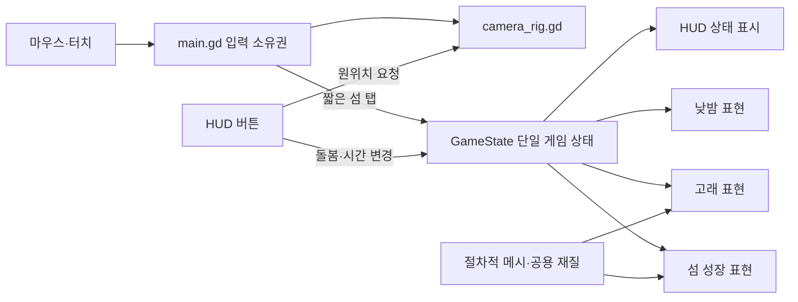

# 공중섬 프로젝트 — 작업 시작 요약

확인일: 2026-10-06. Codex가 실제 설정·코드·기존 문서·Git 상태·저장된 기준 이미지를 읽어 작성했다. 이번 확인은 정적 검토이며 게임 실행·테스트 재실행·새 렌더·실기기 검증을 포함하지 않는다.

## 먼저 알아둘 현재 상태

- **플레이 가능한 세로형 시각·조작 프로토타입**이다. 작은 섬의 성장, 낮밤 변화, 하늘고래가 만드는 감정을 확인하는 단계이며 완성 게임은 아니다.
- 구현된 범위: 섬 하나, 시작 단계 0과 성장 단계 1~3, 짧은 돌봄, 낮/노을/밤, 고래 한 마리, 회전·확대·원위치, 임시 영어 UI.
- 2026-10-03 자동 검사 **177개 통과**와 데스크톱 Metal Mobile 렌더 **8장**의 기록이 있다. 이번에 낮 최종 단계와 고래 기준 이미지를 열어 확인했다. 과거 이미지를 보는 것은 현재 실행 검증이 아니다.
- Android/iOS 실행·터치 감각·FPS·메모리·발열·배터리, 사용자 반응과 장기 재미는 미검증이다. 목표 기기와 프레임 목표도 아직 정해야 한다.
- 저장·오프라인·경제·환생·광고·결제·다수 섬/식물·최종 아트/사운드는 현재 범위에 없다.

## 문서의 역할과 읽는 순서

1. [AGENTS.md](../AGENTS.md), [CLAUDE.md](../CLAUDE.md): 작업 지침과 역할 분담.
2. 이 문서: 구조와 현재 상태의 빠른 진입점.
3. [vision.md](vision.md): 확정 콘셉트와 제외 범위.
4. [status.md](status.md): 구현·검증·미검증 사실.
5. [roadmap.md](roadmap.md): 다음 단계와 완료 조건.
6. [handoff.md](handoff.md), [README.md](../README.md): 작업 주의점, 실행·검사·캡처 방법.
7. [work-log.md](work-log.md): 변경과 판단의 이력.

이 요약은 기준 문서를 대체하지 않는다. 문서와 코드가 다르면 차이를 기록하고 게임 규칙은 사용자 결정 없이 바꾸지 않는다.

## 구조와 수정 위치

| 역할 | 파일 | 책임과 주의점 |
| --- | --- | --- |
| 프로젝트 설정 | [project.godot](../project.godot) | Mobile 렌더러, 세로 1080×1920, 데스크톱 540×960, GameState autoload |
| 씬 조립 | [main.tscn](../scenes/main.tscn) | World, Clouds, SkyWhale, SkyCycle, CameraRig, HUD 연결 |
| 게임 상태 | [sky_island_state.gd](../scripts/state/sky_island_state.gd) | 성장·돌봄·시간·고래 타이머의 단일 소스. advance(delta)로 결정적 시간 진행 |
| 입력 분배 | [main.gd](../scripts/main.gd) | _input에서 포인터 생명주기 관찰, UI/돌봄/카메라 소유권, 취소·초점 상실 처리 |
| 카메라 | [camera_rig.gd](../scripts/camera_rig.gd) | 수평 360°, 수직 15~60°, 거리 6.9~16. 기본 0°/22°/11.1, 자동 복귀 없음 |
| 성장 표현 | [island_world.gd](../scripts/world/island_world.gd) | 단계별 소품, 지형 교체·확장, 돌봄 반응과 성장 연출 |
| 하늘·환경 | [sky_cycle.gd](../scripts/world/sky_cycle.gd), [cloud_field.gd](../scripts/world/cloud_field.gd) | 상태에서 낮밤 블렌드를 읽어 하늘·광원·재질 표현, 구름 이동 |
| 고래 표현 | [sky_whale.gd](../scripts/world/sky_whale.gd) | GameState의 비행 진행률로 경로 위치 표시, 지느러미·꼬리·발광 표현 |
| 절차적 지형 | [island_shell.gd](../scripts/art/island_shell.gd) | 단계별 연결된 외곽·절벽·바닥, 실제 삼각형 표면 높이와 안정된 소품 위치 |
| 메시·재질 | [low_poly.gd](../scripts/art/low_poly.gd), [mesh_kit.gd](../scripts/art/mesh_kit.gd), [palette.gd](../scripts/art/palette.gd), [whale_mesh.gd](../scripts/art/whale_mesh.gd) | 공용 메시·재질, 고래 형태. 이전 온실 에셋을 가져오지 않음 |
| 셰이더 | [sky_gradient.gdshader](../assets/shaders/sky_gradient.gdshader), [foliage_sway.gdshader](../assets/shaders/foliage_sway.gdshader) | 하늘·별·달과 식물 흔들림. 달은 실제 광원이 아님 |
| UI | [hud.gd](../scripts/ui/hud.gd), [hud.tscn](../scenes/hud.tscn) | 상태 표시와 조작 요청. 게임 진행 상태를 별도로 복제하지 않음 |
| 회귀 검사 | [prototype_test.gd](../tests/prototype_test.gd) | 상태·메시·지형·소품·입력·씬·구도 검사 |
| 기준 캡처 | [capture_prototype.gd](../tools/capture_prototype.gd) | 실제 창이 필요하며 프로젝트 내 기준 PNG 8장을 덮어씀 |



## 현 구현을 오해하지 않기

- 성장에 필요한 돌봄은 단계당 3회, 총 9회다. 성장 중에는 1.5초 입력 잠금이 있다. 낮밤과 무관하게 성장할 수 있다. 수치는 상태 스크립트의 상수이며 장기 밸런스 데이터 시스템은 아직 없다.
- '영구 성장'은 이전 소품과 진행이 현재 실행 안에서 유지된다는 뜻이다. 저장이 없으므로 앱을 다시 실행하면 시작 상태로 돌아간다.
- 자동 낮/노을/밤 유지 시간은 26/9/32초, 전환은 2.5초다. 수동 시간 버튼은 자동 주기를 멈춘다. Auto 버튼은 자동 주기를 토글한다.
- 고래 방문 조건은 최종 성장 단계와 밤이다. 첫 대기 2초, 비행 16초이며 비행 전체가 화면 안에 머무는 것은 아니다. 첫 방문 후에도 조건이 유지되면 방문 종료 뒤 24초 대기로 반복한다. '고래 한 마리/한 번 방문 검증'을 '반복 방문 없음'으로 해석하지 않는다.
- 밤 조건 판정은 시각 블렌드 완료 여부가 아니라 목표 시간 단계 기준이다. 하늘이 밝아지면 대기 중 방문은 취소되지만 이미 시작된 방문은 타이머 종료까지 진행한다. 이는 현 코드 설명이며 새로운 설계 확정이 아니다.
- 섬 탭 판정은 카메라 광선과 높이 0 평면의 교차점·현재 외곽을 사용한다. 실제 삼각형을 충돌 검사하는 방식은 아니다. 높이·부유·실기기 조작에서 느낌을 확인해야 한다.
- 구도 검사는 기본 거리에서 수평 8방향과 수직 양 끝을 표본 검사한다. 모든 회전·확대 조합의 시각 품질을 보증하지 않는다. 가까이 확대할 때 일부 잘림은 기존 관찰 모드 의도다.

## 실행 환경과 검증 경계

설치된 실행 파일의 --version 결과는 **4.7.2.stable.official.ed1daf0bf**다. 설정은 Mobile 렌더러/GDScript이며 모바일 배포 설정이 완료되었다는 뜻은 아니다. 현재 파일 목록에는 export_presets.cfg가 없다.

```sh
# 직접 플레이
/Applications/Godot.app/Contents/MacOS/Godot --path /Users/mindalhong/Desktop/Project/sky_island_prototype

# 헤드리스 회귀 검사 — 이번 정리에서는 실행하지 않음
/Applications/Godot.app/Contents/MacOS/Godot --headless --path /Users/mindalhong/Desktop/Project/sky_island_prototype --script res://tests/prototype_test.gd
```

헤드리스 검사는 GPU 렌더와 손으로 조작한 실기기 검증을 대신하지 않는다. 씬·에셋 수정 후 import 검사와 실제 렌더도 분리해 기록한다. 캡처 실행 명령과 덮어쓰는 이미지 목록은 [README.md](../README.md)에 있다.

기준 화면: [시작 섬](images/01_stage0_day.png), [완전히 자란 낮](images/04_stage3_day.png), [밤](images/05_stage3_night.png), [고래](images/06_sky_whale.png), [회전](images/07_stage3_orbit.png), [확대](images/08_stage3_close.png). 총 8장 존재를 확인했다.

## Git와 작업 방식

- 확인 당시 브랜치는 main, HEAD는 889065e, 앞선 커밋은 d5a97bf다. git remote -v 출력이 없어 등록된 원격은 없다. 커밋·배포는 이번 요청 범위가 아니다.
- 이번 정리 시작 전부터 미커밋 변경이 있었다: AGENTS.md, status/handoff/work-log 수정과 CLAUDE.md, roadmap.md 추가. 코드·씬·셰이더·테스트·도구·README는 HEAD 대비 변경이 없었다. 이 상태는 시점 기록이므로 다음 작업에서 Git 상태를 다시 확인한다.
- Codex는 구조·계획·문서·검토·최종 검증을 맡고, 코드·씬·재질·테스트·스크립트 구현과 지정 검사 실행은 Claude Code에 위임한다. 첫 구현 위임 전에 지정 claude-implementation 스킬을 읽고 scripts/run.py를 사용한다.
- 한 파일 범위에 한 작성자만 둔다. 기존 변경을 보존하며 각 작업의 목표·허용 파일·완료 조건·검증 방법·의존성을 정한다. CLI 위임 대기는 최대 60초 단위의 긴 대기와 완료 알림을 사용한다.
- 밤의 온실 두 저장소는 읽기 전용이다. 기존 경제·환생·광고/결제를 자동 이식하지 않는다. 새로운 기능·기획 변경·외부 배포는 별도 사용자 지시를 따른다.

## 다음 작업의 출발점

1. 직접 60~90초 체험을 플레이해 성장 가독성, 돌봄/회전 분리, 고래 시인성을 기록한다.
2. 목표 Android/iOS 기기와 프레임 기준을 정한 뒤 빌드·입력·성능을 실측한다.
3. 결과에 따라 미감·아트 고도화 범위를 사용자와 결정한다. 장기 성장·저장·경제·수익화는 별도 설계 단계다.

이번 요청의 완료 범위는 프로젝트 파악과 문서 정리다. 위 단계는 로드맵의 다음 순서이며 이번에 구현하거나 검증한 결과가 아니다.
